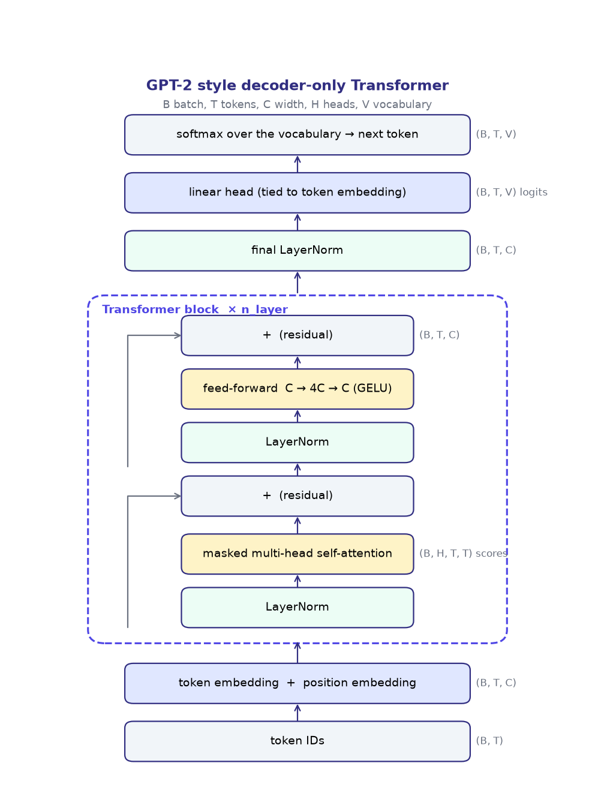
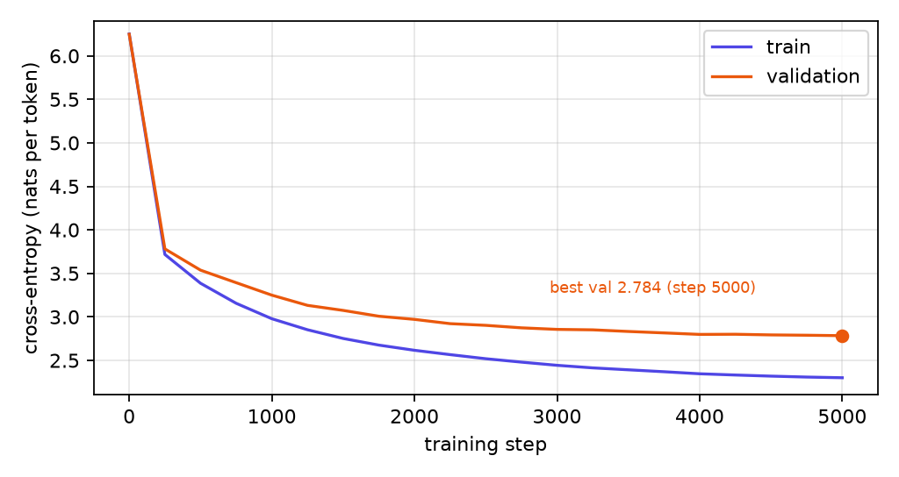
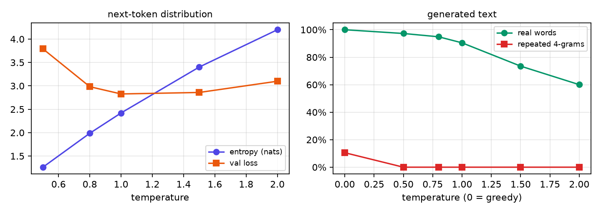
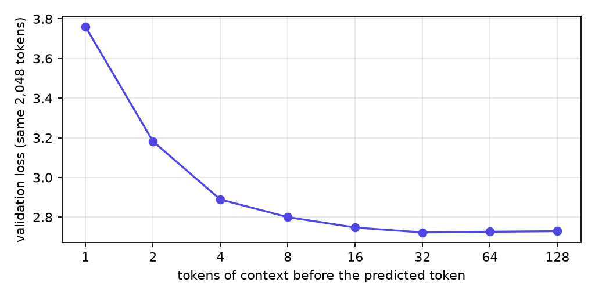
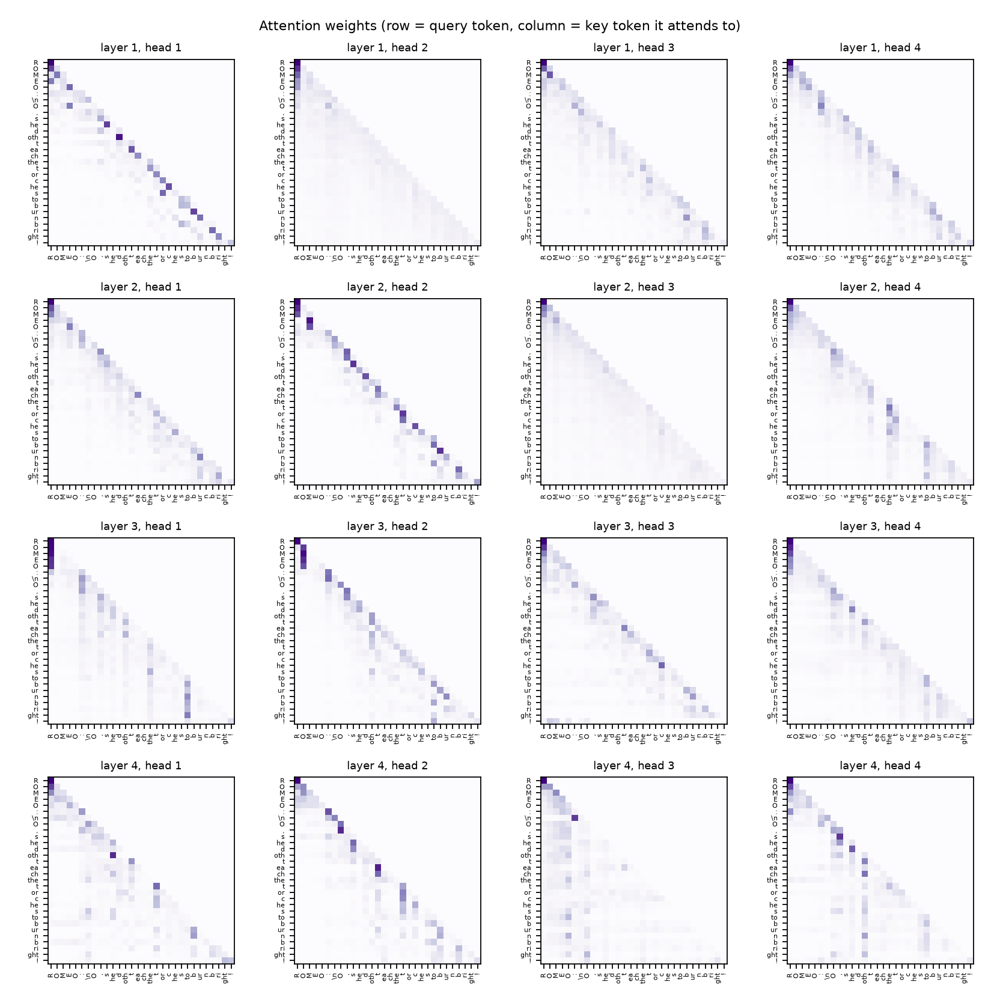
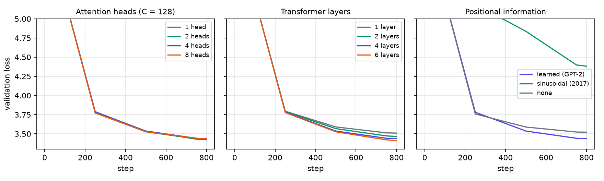

# Technical report: from *Attention Is All You Need* to my GPT-2

Leul Negash

This report explains the Transformer of Vaswani et al. (2017), how GPT-2 changed it, how my implementation
works tensor by tensor, and what my experiments showed. Every equation is linked to the line of code that
computes it.

**Contents**
1. [Understanding *Attention Is All You Need*](#1-understanding-attention-is-all-you-need)
2. [From the original Transformer to GPT-2](#2-from-the-original-transformer-to-gpt-2)
3. [My implementation](#3-my-implementation)
4. [Experiments and findings](#4-experiments-and-findings)
5. [Limitations, challenges and lessons](#5-limitations-challenges-and-lessons)

---

## 1. Understanding *Attention Is All You Need*

### 1.1 The problem the Transformer solves

Before 2017 the best sequence models (for translation, for example) were recurrent networks (RNNs, LSTMs), usually
with attention added on top. A recurrent network reads a sentence one token at a time and keeps a hidden state
`h_t = f(h_{t-1}, x_t)`. That design has two problems:

1. **It cannot be parallelised over the sequence.** `h_t` needs `h_{t-1}`, so a 100-token sentence needs 100
   steps one after another, even on a GPU with thousands of cores. Training is slow, and long sequences are expensive.
2. **Distant words are far apart.** Information from token 1 reaches token 100 only by passing through 99 updates of
   the hidden state, and gets diluted on the way. Long-range dependencies are hard to learn.

The Transformer removes recurrence completely and uses only **attention**: every token looks directly at every other
token in one step. All positions are computed in parallel, and any two tokens are connected by a path of length 1.
The paper's base model reached state-of-the-art translation quality after only 12 hours of training on 8 GPUs, and
the big model set new records (28.4 BLEU English-German, 41.8 English-French) at a fraction of the training cost
of the previous best models.

### 1.2 Transformer vs RNN / LSTM

| | RNN / LSTM | Transformer (self-attention) |
|---|---|---|
| How a token gets context | through a hidden state passed step by step | directly, by attending to all tokens |
| Sequential operations per layer | O(n) | O(1), all positions at once |
| Path length between two tokens | O(n) | O(1) |
| Cost per layer (n tokens, width d) | O(n · d²) | O(n² · d) |
| Knows word order by | its structure (it reads in order) | positional encodings that must be added |
| Memory of the past | squeezed into one vector `h_t` | every past token is still there to look at |

(These rows follow Table 1 of the paper.) The cost `O(n² · d)` is the price: attention compares every pair of
tokens, so doubling the context quadruples the score matrix. For sentences (n smaller than d) this is cheaper than
an RNN; for very long documents it becomes the bottleneck. In my model n = 128 and d = 128.

### 1.3 Scaled dot-product attention

Each token's vector `x` is turned into three vectors by three learned matrices:

- **query** `q = x W_Q`: *what am I looking for?*
- **key** `k = x W_K`: *what do I contain?* (what I advertise to others)
- **value** `v = x W_V`: *what do I hand over if someone attends to me?*

Stacking them for all tokens gives matrices Q, K, V, and

```
Attention(Q, K, V) = softmax( Q Kᵀ / √d_k ) V
```

Step by step, for token i:

1. **Scores:** `s_ij = q_i · k_j / √d_k` measures how well token j's key matches token i's query.
2. **Weights:** `a_ij = softmax_j(s_ij)`, so the weights are positive and sum to 1 over j.
3. **Output:** `out_i = Σ_j a_ij v_j`, a weighted average of the values.

**Why divide by √d_k?** If the components of q and k are independent with mean 0 and variance 1, the dot product
`q · k` is a sum of d_k such products, so its variance is d_k. With d_k = 64 the scores would spread over roughly
±8 to ±16, the softmax would put almost all weight on one token, and its gradient would be close to zero.
Dividing by √d_k brings the variance back to 1. In my model d_k = 32.

**A worked example** (3 tokens, d_k = 2, with the causal mask that GPT uses):

| token | q = k | v | scores (÷√2) | weights after mask + softmax | output |
|---|---|---|---|---|---|
| 1 | (1, 0) | (1, 0) | 0.707, −, − | 1.00, 0, 0 | (1.00, 0.00) |
| 2 | (0, 1) | (0, 2) | 0.000, 0.707, − | 0.33, 0.67, 0 | (0.33, 1.34) |
| 3 | (1, 1) | (3, 3) | 0.707, 0.707, 1.414 | 0.25, 0.25, 0.50 | (1.76, 2.01) |

Token 3's query matches its own key best (score 1.414), so it takes half of its output from its own value.
Token 1 can only see itself, so it copies its own value. In code this is `model.py`, `CausalSelfAttention.forward`:

```python
scores = q @ k.transpose(-2, -1) / math.sqrt(D)                     # (B, H, T, T)
scores = scores.masked_fill(~self.mask[:T, :T], float("-inf"))       # causal mask
weights = F.softmax(scores, dim=-1)
out = self.attn_drop(weights) @ v                                    # (B, H, T, D)
```

### 1.4 Why multiple heads

One attention head produces one set of weights per token, so it has to average everything it wants to look at
into one mixture. But a token often needs several kinds of information at once: the previous word, the subject
of the sentence, the speaker's name, the last punctuation mark. **Multi-head attention** runs h smaller attentions in
parallel, each with its own W_Q, W_K, W_V projecting into a d_k = d/h dimensional subspace:

```
head_i = Attention(Q W_Q^i, K W_K^i, V W_V^i)
MultiHead(Q, K, V) = Concat(head_1, …, head_h) W_O
```

Each head can learn a different relation, and W_O mixes their results. Because each head is d/h wide, h heads cost
about the same as one full-width head. The paper used h = 8 heads of d_k = 64 (d = 512); GPT-2 small uses 12 heads of
64; I use 4 heads of 32. In code all heads are computed in one matrix multiply: `qkv` produces all of them,
`view(B, T, H, D).transpose(1, 2)` splits them into a head dimension, and `transpose(1, 2).view(B, T, C)`
concatenates them again before `proj` (W_O). My heads experiment (Section 4.6) tests this directly.

### 1.5 Positional encodings

Attention by itself does not know order. If I shuffle the input tokens, every token gets the same scores with the
same tokens, just in a different row: attention treats its input as a **set**. "the dog bit the man" and "the man
bit the dog" would look the same. So position must be added to the input:

```
x_t = token_embedding(token_t) + position_embedding(t)
```

The paper used fixed **sinusoids**:

```
PE(pos, 2i)   = sin(pos / 10000^(2i/d))
PE(pos, 2i+1) = cos(pos / 10000^(2i/d))
```

Each pair of dimensions is a clock running at a different speed, from a period of 2π up to 10000 · 2π positions.
Together they give every position a unique pattern, nearby positions get similar patterns, and the encoding of
`pos + k` is a linear function (a rotation) of the encoding of `pos`, which makes relative positions easy to read.
The paper also tried **learned** position embeddings and found almost identical results (Table 3, row E); it kept
sinusoids because they might extrapolate to longer sequences. GPT-2 uses learned embeddings. I implemented both, plus
a model with no positions at all, and compared them (Section 4.6).

### 1.6 Feed-forward network, layer normalisation, residual connections

**Feed-forward network (FFN).** After attention has gathered information from other tokens, each token is processed
on its own by the same two-layer network:

```
FFN(x) = max(0, x W_1 + b_1) W_2 + b_2          (paper, ReLU, d → 4d → d)
FFN(x) = GELU(x W_1 + b_1) W_2 + b_2            (GPT-2 and my code)
```

"Position-wise" means it never mixes tokens; that is attention's job. A useful summary is: **attention moves
information between tokens, the FFN transforms the information inside each token.** The FFN holds about two-thirds of
each block's parameters (66k + 66k of 198k in my blocks), and much of what the model "knows" lives there.

**Residual connections (the addition).** Every sublayer is wrapped as `x + Sublayer(x)`: the sublayer computes an
*update* that is added to its input, instead of replacing it. This addition does two things:

1. **The residual stream.** The vector `x` flows through the whole network, and each attention and FFN layer reads
   from it and adds its contribution. The output of block 4 still contains the token embedding plus every
   change that was added. Nothing has to be re-learned to be passed on.
2. **A gradient highway.** The derivative of `x + F(x)` is `I + F'(x)`. The identity `I` means the gradient
   reaches early layers unchanged even if `F'` is small, so deep networks still train (the idea of ResNets, He et al. 2016).

The other addition in the Transformer is at the input, `token embedding + position embedding`: the two pieces of
information share the same vector space, and the first layer receives both together.

**Layer normalisation.** For each token separately, LayerNorm subtracts the mean of its d features and divides by
their standard deviation, then applies a learned gain γ and shift β:

```
LN(x) = γ · (x − mean(x)) / √(var(x) + ε) + β
```

It keeps the scale of the activations stable as more and more updates are added to the residual stream, which
makes training stable and allows larger learning rates. Unlike batch normalisation it works per token, so it does
not depend on the batch size or on other sequences in the batch. My `LayerNorm` class matches `F.layer_norm`
to 1e-5 (tested).

---

## 2. From the original Transformer to GPT-2

### 2.1 The encoder-decoder architecture

The original Transformer was built for translation, so it has two stacks of 6 layers each:

- **Encoder:** reads the whole source sentence (e.g. English). Each layer has unmasked self-attention (every word
  sees every other word, before and after) and an FFN. Output: one vector per source word.
- **Decoder:** writes the target sentence (e.g. German) one token at a time. Each layer has three sublayers:
  1. **masked self-attention** over the target words produced so far,
  2. **cross-attention**: queries come from the decoder, keys and values come from the encoder's output, so each
     target word can look up the source words it needs,
  3. an FFN.

The main difference between the two halves: **the encoder understands a complete input and can look in both
directions; the decoder generates output and may only look backwards, plus at the encoder through cross-attention.**

### 2.2 Why GPT-2 is decoder-only

GPT-2's task is **language modelling**: given text, predict the next token. There is no separate source sentence
to encode, only one stream of text that the model continues. So the encoder and the cross-attention sublayer have
nothing to do, and GPT-2 keeps only the decoder stack, with masked self-attention and FFN. The reasons this works well:

- **Any text is training data.** Next-token prediction needs no labels; GPT-2 trained on 40 GB of web text (WebText).
- **Every task becomes continuation.** Translation, summarising or answering questions can be written as a prompt to
  continue, which is why GPT-2 could do some tasks "zero-shot".
- **Simpler and uniform.** One kind of block repeated, one stream, one objective.

### 2.3 Masked, unmasked and cross-attention

| | Unmasked self-attention | Masked (causal) self-attention | Encoder-decoder cross-attention |
|---|---|---|---|
| Queries from | the sequence itself | the sequence itself | the decoder |
| Keys and values from | the sequence itself | the sequence itself | the encoder output |
| Token i can see | all tokens, before and after | tokens 1 … i only | all source tokens |
| Used in | Transformer encoder, BERT | Transformer decoder, GPT-2, **my model** | Transformer decoder only |
| Good for | understanding a whole input | generating text left to right | connecting output to input |

### 2.4 How causal masking enables autoregressive generation

The mask sets the score of every future token to −∞ before the softmax, so its weight becomes exactly 0
(e^−∞ = 0). Row i of the attention matrix then only covers tokens 1 … i, so the output at position i depends only
on the tokens up to i. This gives two things:

1. **Training in parallel.** One sequence of 128 tokens gives 128 training examples at once: position 1 predicts
   token 2, position 2 predicts token 3, and so on, all in a single forward pass, and none of them can cheat by
   looking at the answer.
2. **Generation that matches training.** At generation time the future does not exist yet. Because the model was
   trained never to look at the future, it behaves the same way: run the model on the text so far, take the logits
   at the **last** position, choose a token, append it, repeat (`GPT.generate`).

My no-mask experiment (Section 4.6) shows what happens without it: the loss looks better because each position can
see the token it has to predict, but at the last position, where there is nothing to copy, the model is much worse,
and it is useless for generation.

### 2.5 Main differences between the original Transformer and GPT-2

| | Transformer (2017, base) | GPT-2 (2019) | My model |
|---|---|---|---|
| Structure | encoder + decoder, 6 + 6 layers | decoder only, 12–48 layers | decoder only, 4 layers |
| Task | translation | language modelling | language modelling |
| Positions | fixed sinusoids | learned embeddings, 1024 positions | learned, 128 (sinusoidal tested too) |
| Normalisation | **post-LN**: `LN(x + Sublayer(x))` | **pre-LN**: `x + Sublayer(LN(x))`, plus a final LN | pre-LN + final LN |
| Activation | ReLU | GELU | GELU (tanh approximation) |
| Width / heads | d = 512, 8 heads | d = 768–1600, 12–25 heads | d = 128, 4 heads |
| Tokenizer | BPE, 37k shared vocabulary | byte-level BPE, 50,257 tokens | byte-level BPE, 512 tokens |
| Initialisation | standard | residual projections scaled by 1/√(2N) | same as GPT-2 |
| Output layer | tied with embeddings | tied with embeddings | tied |
| Parameters | 65 M | 117 M – 1.5 B | 0.88 M |

**Why pre-LN?** In post-LN the residual stream itself is normalised after every block, and gradients to early layers
must pass through every LayerNorm; such models need a careful learning-rate warm-up to train at all. In pre-LN the
residual path `x → x + …` is a clean identity from the input to the output, which trains more stably in deep stacks.
Because the stream itself is never normalised, GPT-2 adds one final LayerNorm before the output layer.

---

## 3. My implementation

All code is in this repository: `tokenizer.py` (BPE), `model.py` (the Transformer), `train.py` (training),
`generate.py` (text generation) and `experiments.py`. The only building blocks I take from PyTorch are
`nn.Linear`, `nn.Embedding`, `nn.Dropout`, softmax, cross-entropy and the AdamW optimiser. I wrote LayerNorm,
GELU, the attention, the heads, the blocks and the positional encodings myself; the tests check LayerNorm, GELU and
attention against PyTorch's built-in versions.

### 3.1 Tokenizer and embeddings

**Tokenizer.** I implemented byte-level BPE, the same kind as GPT-2: start with the 256 possible bytes (so any text
can be encoded, nothing is ever "unknown"), then repeatedly find the most frequent adjacent pair of tokens and merge
it into a new token. Like GPT-2, text is first split into word-like chunks so merges never cross word boundaries.
I trained 256 merges on the training text only, giving **512 tokens**. Examples of what it learned:
`"To be, or not to be: that is the question."` → `To | ␣be | , | ␣ | or | ␣not | ␣to | ␣be | : | ␣that | ␣is | ␣the | ␣ | q | u | est | ion | .` (18 tokens). One token is on average about 1.9 characters.
Decoding concatenates the bytes of each token, so `decode(encode(text)) == text` exactly (tested).

*Why 512 and not 50,257?* GPT-2's vocabulary was trained on 40 GB; I have 1 MB. A large vocabulary would create
thousands of tokens that appear only a handful of times, each needing its own embedding learned from very few
examples, and the embedding table alone would be bigger than the rest of my model. With 512 tokens every token is
seen often, and a 128-token context still covers about 250 characters.

**Embeddings.** `tok_emb` is a 512 × 128 table: row j is the learned vector for token j. `pos_emb` is a 128 × 128
table: row t is a learned vector for position t. The input to the first block is their sum, so each token vector
says *what* the token is and *where* it is.

### 3.2 Data flow and tensor shapes

With batch B = 32, context T = 128, width C = 128, H = 4 heads of D = 32, vocabulary V = 512:



| Step | Operation | Shape |
|---|---|---|
| input | token IDs | (32, 128) |
| embeddings | `tok_emb(idx) + pos_emb(arange(T))` | (32, 128, 128) |
| **block, attention part** | `LN(x)` | (32, 128, 128) |
| | `qkv(x)`: one linear layer for Q, K, V of all heads | (32, 128, 384) |
| | split into q, k, v | 3 × (32, 128, 128) |
| | `view(B, T, H, D).transpose(1, 2)`: separate the heads | (32, 4, 128, 32) |
| | `q @ kᵀ / √32`: scores | (32, 4, 128, 128) |
| | mask + softmax: attention weights | (32, 4, 128, 128) |
| | `weights @ v` | (32, 4, 128, 32) |
| | `transpose(1, 2).view(B, T, C)`: concatenate heads | (32, 128, 128) |
| | `proj` (W_O), then `x + …` | (32, 128, 128) |
| **block, FFN part** | `LN(x)`, `fc` | (32, 128, 512) |
| | GELU, `proj`, then `x + …` | (32, 128, 128) |
| × 4 blocks | | (32, 128, 128) |
| output | final LN, `lm_head` (tied to `tok_emb`) | (32, 128, 512) |
| loss | cross-entropy with the targets | scalar |

**Parameter count** (875,264 in total): token embedding 65,536; position embedding 16,384; each block 198,272
(attention 66,048, FFN 131,712, two LayerNorms 512); final LayerNorm 256; the output layer adds nothing because it
shares the token embedding's weights.

### 3.3 Training pipeline

- **Data.** Tiny Shakespeare (1.1 MB, about 40,000 lines of plays). The first 90% is training text (516,405 tokens),
  the last 10% validation (59,401 tokens). The split is contiguous, so lines of the same scene never end up on both
  sides.
- **Input-target pairs.** A random window of 129 tokens gives the input (first 128) and the target (the same window
  shifted left by one): the target at every position is simply the next token.
- **Loss.** Cross-entropy between the logits and the next token, averaged over all 32 × 128 positions:
  `L = −(1/N) Σ log p(next token)`. An untrained model predicts roughly uniformly, so its loss starts at
  ln 512 = 6.24 (my run starts at 6.25).
- **Optimiser.** AdamW (β = 0.9, 0.95) with weight decay 0.1 on the weight matrices only, gradient clipping at 1.0,
  learning rate 1e-3 with 200 warm-up steps and cosine decay to 1e-4. These are GPT-2/GPT-3 practice, with a larger
  peak rate because my model is small.
- **Regularisation.** Dropout 0.1 after the embeddings, on the attention weights and on each sublayer output.
- **Validation.** Every 250 steps, train and validation loss on the same fixed 20 batches each time, so the curve
  is not noisy from batch choice.
- **Checkpoints.** `checkpoints/gpt_best.pt` stores the model with the lowest validation loss;
  `checkpoints/gpt_last.pt` stores everything needed to continue (weights, optimiser state, step, history, random
  states). `--stop_at` pauses a run and `--resume` continues it; a test checks that a paused and resumed run gives
  exactly the same loss as an uninterrupted one.

### 3.4 Text generation

`GPT.generate` repeats: crop the text to the last 128 tokens, run the model, take the logits at the last position,
divide them by the temperature τ, and pick the next token:

- **greedy** (τ = 0): always the most likely token;
- **sampling**: draw from `softmax(logits / τ)`. τ < 1 sharpens the distribution towards likely tokens, τ > 1
  flattens it towards uniform. An optional top-k keeps only the k most likely tokens.

## 4. Experiments and findings

All numbers below come from `results/` and can be reproduced with the commands in the README.

### 4.1 Training and validation loss



| step | 0 | 250 | 1000 | 2000 | 3000 | 4000 | 5000 |
|---|---|---|---|---|---|---|---|
| train loss | 6.252 | 3.717 | 2.979 | 2.616 | 2.444 | 2.346 | 2.301 |
| validation loss | 6.248 | 3.782 | 3.250 | 2.971 | 2.856 | 2.799 | **2.784** |

- **Start:** 6.25 = ln 512, the loss of a uniform guess over the vocabulary, so the initialisation is right.
- **First 250 steps:** the loss falls to 3.7. The model quickly learns the easy statistics: which tokens are
  common, that names are followed by a colon and a new line, that words are separated by spaces.
- **After that:** slow, steady improvement as it learns words, then short phrases and the structure of a play
  (speaker name, colon, verse lines, blank line between speeches).
- **Overfitting:** from about step 1000 the training loss falls faster than the validation loss, and the gap grows
  from 0.27 to 0.48. The model is starting to memorise lines of the training plays. But validation loss was still
  going down at step 5000 (the last 1000 steps gained only 0.015), helped by the learning rate decaying, so the best
  checkpoint is the last one. Training much longer would mainly increase the gap.
- **Final:** validation loss 2.784, perplexity e^2.784 = 16.2. On average the model is about as uncertain as a choice
  between 16 tokens, against 512 for a random guess. Training took 5,000 steps (20.5 million tokens, about 40 passes
  over the training text) in about 70 minutes on 4 CPU threads.

### 4.2 Generated text

Temperature 0.8, prompt `ROMEO:` (more in `results/samples.txt`):

```
ROMEO:
As the rovil, with a pawdy palace:
As that few, did I see the law:
Whilst thou remember thy heart's purposed times;
And mayst thou draw thy soul bed,
Show her from the breaking gentleman:
So, Richard, our father's life,
I am favour'd nor no more in the matter of mine.

DUKE OF YORK:
To meet a royal traitor, thou kissand move to do;
```

The model has learned the form of a play: speaker names in capitals followed by a colon, verse lines starting with
a capital letter, blank lines between speeches, real character names (Richard, Duke of York), archaic words
("thou", "mayst", "favour'd") and mostly correct short phrases. It has not learned meaning: sentences do not make
sense beyond a few words, and some words are invented ("rovil", "pawdy"). This is what a 0.9M-parameter model
trained on 1 MB can do.

### 4.3 Temperature



| temperature | entropy of the next-token distribution | probability of the top token | real words | repeated 4-word sequences | distinct words |
|---|---|---|---|---|---|
| greedy (0) | – | – | 100.0% | 10.5% | 41.7% |
| 0.5 | 1.26 | 0.63 | 97.3% | 0.0% | 72.6% |
| 0.8 | 1.99 | 0.48 | 94.9% | 0.0% | 82.2% |
| 1.0 | 2.42 | 0.41 | 90.5% | 0.0% | 84.9% |
| 1.5 | 3.40 | 0.27 | 73.5% | 0.0% | 91.2% |
| 2.0 | 4.20 | 0.17 | 60.0% | 0.0% | 91.6% |

("Real words" = generated words that appear in the training text; measured on 8 samples of 150 tokens each.)

- Dividing the logits by τ changes how peaked the distribution is: the entropy grows from 1.26 to 4.20 nats as τ goes
  from 0.5 to 2, and the top token's probability falls from 63% to 17%.
- **Greedy** decoding produces only real words but falls into loops: *"It is a woman's sweet sweet sweet sweet sweet
  sweet"*, *"Why, Warwick, Warwick, Warwick, and Warwick"*. Once the most likely continuation leads back to a state
  it has seen, the argmax repeats it forever: 10.5% of its 4-word sequences are repeats, and only 42% of its words
  are distinct.
- **Low temperature (0.5–0.8)** gives the best text: almost all real words, no loops, varied vocabulary.
- **High temperature (1.5–2)** samples unlikely tokens, and because my tokens are pieces of words, unlikely pieces make
  invented words: *"Jo hatAnd so heI know with his shor neck"*. Only 60% real words at τ = 2.
- τ = 1 gives the lowest validation loss (2.83), as it should: the model was trained to produce calibrated
  probabilities at τ = 1. Sharper (0.5) or flatter (2) distributions both describe real text worse. So τ = 1 is the
  "honest" distribution, and τ < 1 trades diversity for safety.

### 4.4 Prompt length and context

To measure how much context the model uses, I predicted the **same 2,048 validation tokens** while giving the model
only the previous n tokens. Using the same targets for every n removes the noise from which tokens are being
predicted.



| tokens of context | 1 | 2 | 4 | 8 | 16 | 32 | 64 | 128 |
|---|---|---|---|---|---|---|---|---|
| loss | 3.760 | 3.182 | 2.889 | 2.800 | 2.748 | 2.723 | 2.727 | 2.730 |
| perplexity | 42.9 | 24.1 | 18.0 | 16.4 | 15.6 | 15.2 | 15.3 | 15.3 |

- With 1 token of context the model is a bigram model (perplexity 43). Each doubling of context helps, most of all
  the first few tokens: the rest of the word and the previous word are what matters most.
- The gain stops at about **32 tokens** (about 60 characters, one line of verse). Beyond that the model does not use
  the extra context. A model of this size has learned local patterns (spelling, phrases, line structure), not
  long-range ones (who is speaking in this scene, what was said three lines ago).

Generation with prompts of different length (greedy, same validation scene; `results/context_output.txt`):

- **1 token** (`P`): the model completes a name it knows, `POLIXENES:`, then generic lines.
- **16 tokens** (`PETRUCHIO: I pray you do. I`): it stays in the scene: it continues the line, addresses "sir",
  and gives the next speech back to **PETRUCHIO**, a name it took from the prompt.
- **112 tokens** (part of a speech): it continues the verse ("I have done, and I'll prove against thee"), then
  starts a new speaker (DUKE VINCENTIO) and falls into its usual greedy loop.

So a longer prompt sets the style and the characters for the first lines, which agrees with the context
measurement: the model uses the last line or two, and the influence of anything further back is weak.

### 4.5 What the attention heads learned



Attention weights of the trained model for `ROMEO:\nO, she doth teach the torches to burn bright!`. Each row is
a token (query) and shows how much it attends to every earlier token (the upper triangle is empty because of the
causal mask). Different heads clearly do different things, which is the point of multi-head attention:

- **Layer 2, head 2** attends almost entirely to the **previous token** (the line just below the diagonal): a
  "previous-token head" that lets a token know what came right before it.
- **Layer 1, head 1** mostly attends to the token itself and the one before: it builds up the current word from its
  pieces (`R O M E O`, `t ea ch`).
- **Layer 1, head 2** and **layer 2, head 3** spread their attention evenly over the whole past: an average of the
  context.
- **Layer 3, head 1** and **layer 4, head 4** form vertical stripes: many later tokens attend to the same few earlier
  tokens (`to`, `the`, `oth`), which is information that several later tokens need.
- Many heads put weight on the first token. A common pattern in GPT models: when a head has nothing useful to look
  at, it puts its weight on a fixed position (because softmax weights have to sum to 1).

### 4.6 Architecture: heads, layers, positions and the mask

To see what each part of the architecture contributes, I trained 10 variants of the base model (4 layers, 4 heads,
C = 128, learned positions) for 800 steps each, changing one thing at a time. Data, seed, batches and learning-rate
schedule are identical, so the runs differ only in the architecture. "Last-pos val" is the validation loss of the
last position of each window only, where there is no future token that a model could look at.

| variant | parameters | train | val | last-pos val | s/step |
|---|---:|---:|---:|---:|---:|
| base (4 layers, 4 heads, learned) | 875,264 | 3.240 | **3.437** | 3.470 | 0.78 |
| 1 head | 875,264 | 3.230 | 3.422 | 3.439 | 0.58 |
| 2 heads | 875,264 | 3.229 | 3.425 | 3.463 | 0.64 |
| 8 heads | 875,264 | 3.244 | 3.434 | 3.455 | 1.00 |
| 1 layer | 280,448 | 3.328 | 3.509 | 3.558 | 0.24 |
| 2 layers | 478,720 | 3.290 | 3.466 | 3.510 | 0.41 |
| 6 layers | 1,271,808 | 3.219 | 3.412 | 3.470 | 1.15 |
| sinusoidal positions | 858,880 | 4.472 | 4.382 | 4.413 | 0.86 |
| no positions | 858,880 | 3.335 | 3.522 | 3.585 | 0.86 |
| no causal mask | 875,264 | 3.004 | 3.197 | 3.846 | 0.78 |



**Number of heads.** With the width fixed at C = 128, 1, 2, 4 and 8 heads all end within 0.015 of each other, which
is within the noise of a single 800-step run. The parameter count does not change (the heads only split the same
Q, K, V matrices), but more heads are slower on a CPU because the matrices get smaller (0.58 s/step for 1 head,
1.00 for 8). The paper (Table 3, row A) found that one head was 0.9 BLEU worse and that too many heads also hurt. At my
size and training length, the extra "views" that several heads give do not show up yet in the loss, although the
attention maps in 4.5 show that the heads of the trained model do specialise.

**Number of layers.** This is the clearest effect: 3.509 → 3.466 → 3.437 → 3.412 for 1, 2, 4 and 6 layers. Every extra
layer helps, but less each time, and the cost grows linearly (the 6-layer model is 1.5× slower than the 4-layer one for
0.025 nats). One layer can only combine information once; with more layers a token can first gather information
from its neighbours and then use that combined information in the next layer. This matches GPT-2, whose models
differ mainly in depth and width (12 to 48 layers).

**Positional information.** Without any positions the loss is 0.085 worse (3.522), and 0.115 worse at the last
position. The model still works fairly well because the causal mask itself leaks some order information (a token
can tell how much is in front of it from how its attention is spread), but it cannot tell `the king` from `king the`
as well. The surprise was the sinusoidal version: 4.382, far worse than both. The paper found sinusoidal and learned
positions almost equal (Table 3, row E), so I checked why. The sinusoid table has values in [−1, 1], so every
position vector has length √(C/2) = 8, while my token embeddings start with standard deviation 0.02 (length about
0.23). Added together, the input is about 35× more position than token at the start, and even after 800 steps the
position vector is still 9× longer than the token vector (8.0 vs 0.87). In the learned model it is the other way
round: the token vector is 7× longer than the position vector (1.28 vs 0.18). The paper avoids this by multiplying the
token embeddings by √d_model (section 3.4), which I did not do because GPT-2 learns its positions and does not need
it. So the sinusoidal model is not broken (it can memorise a batch in the tests), it is badly scaled and learns
slowly. The lesson is that the two methods are only equivalent when the scales of token and position are matched.

**Causal mask.** Without the mask the validation loss looks better (3.197 vs 3.437), but this is cheating: every
position can attend to the next token, which is the token it has to predict. The last-position loss shows it: there is
no future to copy there, and the model is much worse than the base (3.846 vs 3.470). This model cannot generate text,
because during generation the future does not exist yet. So the mask is what makes the model a language model, and a
low loss alone does not prove that a model is correct; a test that future tokens do not change past predictions is
needed (it is in `tests/test_model.py`).

## 5. Limitations, challenges and lessons

**Limitations.**
- The model is tiny (0.9M parameters vs 124M for GPT-2 small) and the data too (1 MB vs 40 GB). It learns the form of
  Shakespeare, not the meaning.
- It uses only about 32 tokens of context, although it sees 128.
- It starts to overfit: the train-validation gap grows from about step 1000. More data or a larger dropout would be
  needed to train a larger model.
- The architecture experiments are short runs (800 steps) with one seed each, so small differences (a few hundredths
  of a nat) are within noise; I only draw conclusions from large differences.
- Everything ran on a laptop CPU, which limited both the model size and the number of experiments.

**Challenges.**
- **Noisy context measurement.** My first version of the context experiment averaged the loss at each position of
  the window, but each position then predicts different tokens; the noise (about ±0.1) was as large as the effect and
  the curve went up after 32 tokens. I changed it to predict the same 2,048 tokens with different amounts of context,
  which gave the clean curve above.
- **Correctness of attention.** Shapes are easy to get wrong in multi-head attention (a `view` without `transpose`
  silently mixes heads). I tested my attention against PyTorch's `scaled_dot_product_attention`, and added a test
  that changing future tokens does not change past predictions.
- **Resuming.** To pause and resume training on a laptop, the checkpoint must hold not only the weights but the
  optimiser state and the random states for batch order and dropout; a test checks that a paused run gives exactly
  the same loss as an uninterrupted one.
- **Tokenizer speed.** Counting pairs over the whole text for each merge is slow in Python; counting over the distinct
  word chunks (with their frequencies) made training the tokenizer take about 10 seconds.

**Lessons.**
- Attention is a few lines of code: `softmax(QKᵀ/√d)V` with a mask. Most of the work of a Transformer is in the
  details around it: residual connections, LayerNorm placement, initialisation, the learning-rate schedule.
- The causal mask is what makes a Transformer a language model: it gives 128 honest training examples per window,
  and without it the model learns to cheat.
- Position information is essential, and how it is given only stops mattering when its scale matches the token
  embeddings: my unscaled sinusoids drowned out the tokens, which is why the paper multiplies embeddings by √d_model.
- Generation quality depends a lot on decoding: the same model loops with greedy decoding and invents words at
  high temperature.
